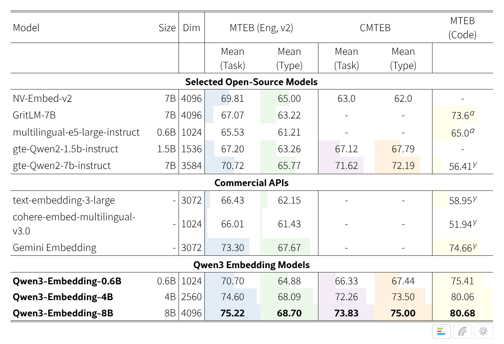
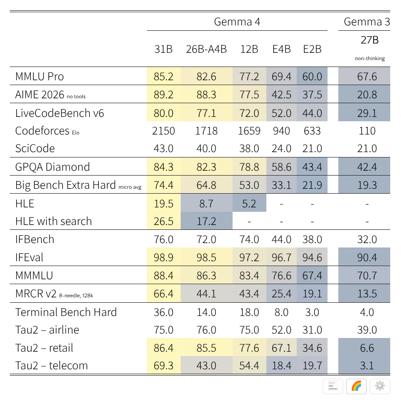

## bar-arxiv-tables

> Richard walks into the arXiv pub after a long day of reviewing machine learning preprints.
> 
> The maître d' greets him at the door, handing him a massive menu — a dense 8-column grid of floating-point numbers, no standard deviations, and inexplicably bolded digits.
> 
> "Welcome to arXiv," the host says. "Would you prefer the bar or a table?"
>
> Richard squints at the dizzying wall of numbers. "You've got to be kidding me. Nobody is calculating all these decimals in their head! We just scan for the bold ones. I'll take the bar — you ought to just bar the table altogether, make it a chart so I can actually see what's going on, and get me a drink."

A userscript to visualize numerical tables in arXiv HTML preprints as bar charts or heatmaps.

### Preview

| Bar Chart Overlay | Heatmap Overlay |
| :---: | :---: |
|  |  |

### Installation

1. Install a userscript manager such as [Violentmonkey](https://violentmonkey.github.io/) or [Tampermonkey](https://www.tampermonkey.net/).
2. [Install the script from GitHub Releases](https://github.com/Mind-Ext/bar-arxiv-tables/releases/latest/download/bar-arxiv-tables.user.js).
3. *(Optional for local files)* In your browser's extension settings, enable "Allow access to file URLs" for your userscript manager.

### How to Use

1. Open any arXiv paper with an HTML version (e.g. `https://arxiv.org/html/...`).
    - Other website URLs can be added to the whitelist in the settings from userscript manager popover.
2. Discoverable numeric tables will display an action toolbar in the lower-right corner:
   - Click 📊 to toggle horizontal bar charts.
   - Click 🌈 to toggle heatmap colors.
   - Click ⚙️ to configure visualization for the current table or set global defaults.

### Disclaimer

The joke (and the code) was written by AI under my supervision.